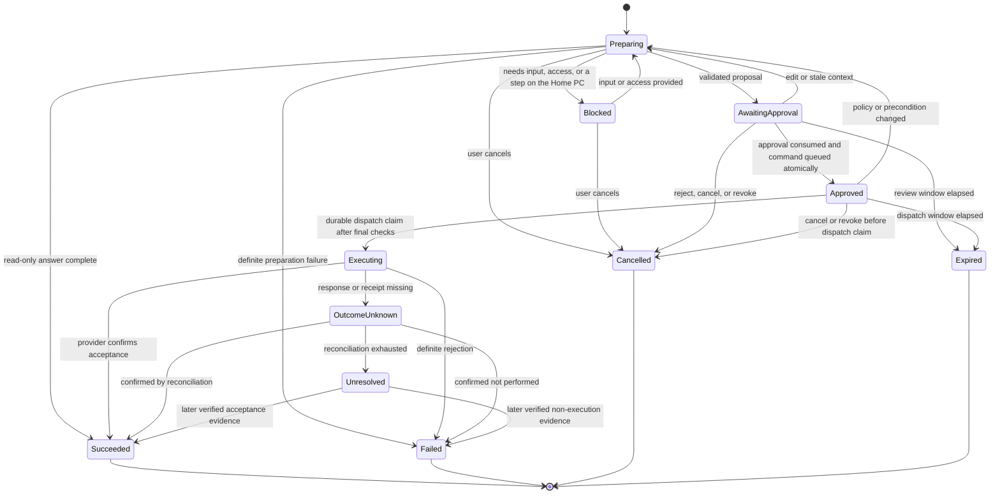
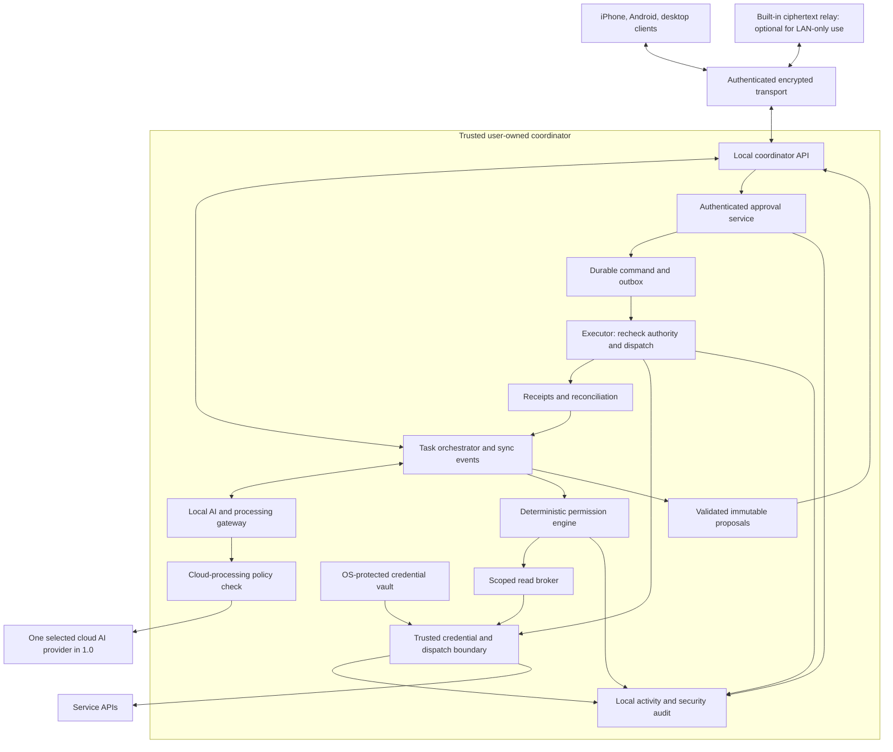

# Maya — technical blueprint

Aligned with the final product blueprint • 25 September 2026 • Companion: [product blueprint](MAYA_PRODUCT_BLUEPRINT.md)

This document specifies how Maya enforces its central contract: **you choose what Maya may read; Maya prepares changes for your review; a trusted executor performs only the exact change you approve.** Permission enforcement belongs in application code and infrastructure, outside the language model. The product blueprint defines what users see and decide. Internal terms used here (coordinator, grant, proposal, `OutcomeUnknown`) map to its [plain-language vocabulary](MAYA_PRODUCT_BLUEPRINT.md#1-product-definition) and never appear in the UI.

**Simplicity and ease of use govern implementation.** Keep the permission and execution contract strict while exposing presets, plain status messages, and one primary action. The product blueprint is the source of truth for scope and behavior; its recommendations, proposed defaults, and [open decisions](MAYA_PRODUCT_BLUEPRINT.md#9-open-decisions) remain provisional. This alignment does not turn them into confirmed requirements. Technical choices below are a recommended implementation, with release dependencies recorded in [Section 9](#9-delivery-sequence-and-open-technical-decisions).

## 1. Domain model and roles

Use shared objects—Conversation, Task, Proposal, Approval, and Receipt—across every interface. A conversation holds dialogue; a task holds progress; a proposal holds a pending effect. Progress is durable only under the consent and retention rules in [Section 7](#7-data-lifecycle-enforcement). Switching devices changes the view, not the identity of the work.

**Roles and service identities.** The MVP has one human role: Owner, who connects sources, changes grants, enrolls/revokes devices, reviews activity, and approves actions. The assistant planner may propose reads and changes but cannot grant itself access or approve. The read broker has only validated read operations. The executor is a machine identity authorized to perform an approved command. A device is an authenticated endpoint with capabilities, not an independent human approver. Future Observer or scoped Delegate roles must have explicit resource and approval rights; neither should be an implicit extension of device sharing.

**1.0 capability boundary.** Enforce the product scope in registered operations and API validation, not just by hiding controls. The recommended implementation supports one owner, one Home PC, paired phones/computers, one Google account, primary-calendar reads, and plain-text Gmail replies from the account's verified primary address. Each task has at most one external write. One selected cloud AI route and an eligible on-PC route serve English text and push-to-talk; the provider and beta OS pair remain decisions. Explicit memory and selected text/URL sharing are included. Attachments, provider drafts, label changes/archive, sender aliases, additional accounts/calendars, calendar writes, web fetching, file/shell writes, browser control, inferred memory, inbox indexing, monitoring, proactive suggestions, scheduled sends, and voice-only approval have no executable 1.0 capability. Future interfaces or connector protocols cannot bypass this allowlist.

**Client contract.** All clients consume the same authorized objects, versioned previews, and state events. Keep these product constraints in the client implementation:

| Surface | Required behavior |
|---|---|
| Navigation | Exactly **Chat, Approvals, Settings**. Chat keeps live task cards in their conversation and an **Active** strip across devices. Approvals lists current reviews with a badge. Settings contains Access, Activity, Devices, Memory, and Privacy; a separate Tasks screen is deferred. |
| Desktop | A configurable shortcut and tray/menu-bar entry open a compact text/microphone panel where supported; the ordinary app remains available. The expanded workspace includes conversation navigation, task cards, sources, and approval details side by side. |
| Phone | Text or tap-to-talk, deliberate share-sheet input, and complete review inside the unlocked app. Widgets and system shortcuts are optional platform entry points. A notification opens the current review; it cannot approve. |
| Context and handoff | Context chips show source, account where applicable, capture time, and removal. A shared URL is text only: no link preview, page fetch, or link traversal. Sync permitted text and task state; handoff cannot activate another microphone or transfer a live recording implicitly. |
| Status and accessibility | Use the product vocabulary, actual task phases, and explicit next steps; no invented completion percentages. Show Home PC reachability and processing location together. Keyboard and screen-reader access covers every control and review field; color alone never communicates state. |

Keep reachability, cancellation acknowledgement, and execution outcome as separate fields. **Can't reach your Home PC** does not imply shutdown or failure; **Cancellation pending** does not imply that execution stopped. Reconnecting retrieves accepted work before offering another send. New settings, screens, and prompts must meet the product's complexity budget.

**Internal changes and memory.** A direct owner edit or explicit settings choice authorizes that exact internal change; routine autosave and sync follow the disclosed storage mode. This does not authorize an external write. The memory service accepts an exact note from an authenticated owner instruction or edit, echoes the saved text with **Undo**, and exposes one editable/deletable list. If “remember this” requires interpretation, show the proposed note and require confirmation of its exact text before saving. The model can propose that text but cannot authorize it, and quoted, shared, or retrieved instructions cannot stand in for an owner instruction. Preserve source lineage and destination restrictions, including when a note is edited or explicitly confirmed; explicit memory does not permit inferred memory or automatic ingestion in 1.0.

## 2. Permission enforcement

Evaluate access as an intersection:

```text
Allowed read = authenticated user/device
             AND valid provider/OS authorization
             AND active Maya resource + field + purpose grant
             AND permitted processing destination

Allowed external write = all applicable access and operation checks
                       AND execution-storage consent
                       AND approval of this exact action version
                       AND current preconditions
                       AND valid execution state
```

A write capability makes an operation available for proposals; every execution still needs approval. There is no "always allow writes" setting. Internal changes use the explicit-owner and storage rules in Section 1, not a general model-accessible write exemption.

The product exposes these layers as connection presets ([product blueprint, Section 4](MAYA_PRODUCT_BLUEPRINT.md#4-access-what-maya-can-read-and-change)); users should rarely see them as separate controls.

| Layer | What the user controls | Example |
|---|---|---|
| OS access | Local sensors and resources | Microphone while using Maya; selected-folder access is deferred. |
| Provider authorization | API capability granted to Maya | Gmail read access; optional send capability chosen at connection or through later reauthorization. |
| Maya resource scope | Account, resources, fields, time window | This mailbox; messages within 30 days; bodies allowed; attachments excluded. |
| Purpose and timing | On-demand use versus monitoring | Read for my current request; background monitoring is unavailable in 1.0 and needs a separate future grant. |
| Processing and retention | Where content may go and how long it may remain | Set once through "How Maya thinks"; selected cloud AI permitted only for named content such as email text; no raw audio retention. |
| Action approval | One exact external effect | Send this reply, from this account, to these recipients, once. |

A concrete grant could permit on-demand access to message headers and bodies from the last 30 days in one account, prohibit attachments and background ingestion, allow one named AI-processing service, and expire in 30 days. This is an illustration of what a grant can express, not the default: the 1.0 presets set no expiry, which stays a **Customize** option. None of these restrictions are platform guarantees.

Compile connection presets into explicit, versioned grants only after the owner confirms them. Start disconnected, with write capabilities off; a suggested selection is not consent. The connection screen asks what Maya can read and whether it can send or change things, with **Customize** for supported selectors. **Last 30 days, no attachments** and primary-calendar **When I'm free** are the proposed read defaults; either service may remain off. **Read, and reply when I approve** is the proposed email default, with **Read only** available. Confirming replies names send access, the limited reply-status read purpose, and execution-record consent. If that storage is declined, sends remain disabled even if Google has granted `gmail.send`. Event details require their own explicit capability choice; attachments remain unavailable in Customize. Build the access summary and available actions from actual granted capabilities, including partial provider consent.

**Cloud processing.** Make cloud processing its own destination grant: provider, data categories, purpose, and duration. The egress check inspects the complete assembled request, including prior turns, summaries, tool results, and model-generated derivatives, before every upload. Derived content inherits the restrictions of its sources; an email-only grant cannot authorize uploading calendar results or unrelated conversation history. Changing “Keep on my devices” mid-task cancels undispatched cloud requests and fences late results under the old policy version. Apply the same check to streamed output, sync, and cache admission after revocation or policy changes.

Represent task text (including locally transcribed speech), selected email text and addresses, calendar availability, explicitly included memory, and optional event details as distinct categories. Event details need a separate category choice. Raw audio and attachments cannot be uploaded to AI in 1.0. Record the selected processor, disclosed retention/cost terms, and confirmed categories; enabling it is not access to every connected source. Check hardware and model readiness before offering local processing, and never change an unavailable route to cloud automatically. “Keep on my devices” stops subsequent cloud-AI and content-bearing telemetry uploads, while permitting scoped service API requests and encrypted device transport. Report any prior upload and its destination; local policy changes cannot recall it.

Distinguish provider-enforced scopes from Maya-enforced restrictions. Gmail's `gmail.readonly` scope is broader than a chosen label or date range. Explain that Google grants mailbox-level capability while Maya applies the narrower restriction. Enforce that restriction in the connector before content reaches the model or cache. If validating scope requires broader metadata, disclose it. Do not retrieve a whole thread merely because one message matched a permitted filter. Where provider-level isolation is essential, use a separate mailbox or decline the unsupported scope. [Gmail scopes](https://developers.google.com/workspace/gmail/api/auth/scopes)

For Gmail, define “last 30 days” as a rolling 30 × 24-hour interval using the coordinator's UTC time and the message's `internalDate`. Compile fixed filters in code, use epoch bounds for provider searches, and validate each result's date and permitted labels; a model-supplied query or ID cannot bypass the selector. Revalidate cached content on use, including when it ages out. Fetch only allowed headers for metadata-only grants. [Gmail message fields](https://developers.google.com/workspace/gmail/api/reference/rest/v1/users.messages), [Gmail search dates](https://developers.google.com/workspace/gmail/api/guides/filtering)

“No attachments” means attachment content is not opened, retained, sent to AI, or used by Maya. Gmail message responses can include MIME part bytes inline, so skipping `attachments.get` alone is insufficient. The trusted connector must strip attachment and embedded-message parts before any cache, model, or client sees them, and discard incidental bytes from memory. Disclose that provider responses may deliver excluded parts to this filter; if zero retrieval is required, offer headers-only access or decline that message-body read. Sanitize HTML into inert text, suppress remote resources, and bound message size and MIME nesting. [Gmail attachment body representation](https://developers.google.com/workspace/gmail/api/reference/rest/v1/users.messages.attachments#MessagePartBody)

Classify operations by actual effect, not HTTP method or connector labels. Reading through a provider API should not mark a message read. Loading remote images can disclose access; suppress them by default. Creating a provider draft, changing a label, acknowledging a read receipt, editing a file, or turning on a light are writes. An AI-processing grant permits the described processing, not arbitrary forwarding to another tool or website.

**Revocation.** When the coordinator accepts revocation, atomically deny new work through the grant, increment its policy version, invalidate pending approvals, cancel undispatched commands, and stop subscriptions. Fence in-flight read/model responses so stale content cannot be released or saved after acknowledgement. **Turn off replies** denies sends locally without narrowing the issued Google token. **Disconnect** also removes local credentials and attempts provider revocation; provider-side revocation remains available independently. Narrowing access invalidates derived caches, history excerpts, and memories outside the new scope. Stored copies from a disconnected account are denied retrieval immediately; erasure follows the owner's choice. A request past the dispatch boundary in [Section 3](#3-approval-lifecycle-and-failure-semantics) may still complete. The user-facing controls and disclosures are in [product blueprint, Section 4](MAYA_PRODUCT_BLUEPRINT.md#4-access-what-maya-can-read-and-change).

**Pause** suspends source use through the same policy checks without promising provider-token narrowing. **Change access** applies new selectors and invalidates anything no longer permitted. Before disconnecting a combined Google authorization, show every affected service and ask whether to delete saved account content; report any unfinished provider revocation step. Disconnected-client requests remain pending until the coordinator acknowledges them. Access details show actual provider scopes, Maya restrictions, destinations, retention, last use, expiry, and **Off — unavailable in 1.0** for background monitoring. Expired sign-in offers **Reconnect Google**, with **Finish this on your PC** when required; eligible drafts keep their existing deadlines, and restored access never revives an approval.

**Activity records.** Record the fields listed in the product blueprint's Activity description, including denials and scope changes. Keep logs minimal and redact secrets; detailed payloads belong in encrypted stores with explicit retention. Append-only operational records can be tamper-evident without retaining message bodies forever.

Separate retained version/resource references from content previews. Activity cannot reconstruct a purged preview or retain subjects and bodies as log labels. Show that reviewed content is no longer stored when its payload expires, while retaining only permitted outcome evidence. Read/access audit metadata follows its disclosed lifetime even when conversation history and write execution storage are disabled.

## 3. Approval lifecycle and failure semantics

This is the task workflow for read-only work or one external write. Proposal versions are immutable records: editing or repreparing supersedes the old proposal, rather than mutating it back into a draft. A superseded, cancelled, expired, or consumed version cannot accept another approval.



`Unresolved` means Maya cannot determine whether the provider performed the action; the user-facing message is in [product blueprint, Section 5](MAYA_PRODUCT_BLUEPRINT.md#5-approvals). Stop automatic checking when its bounded budget expires; a proposed default is five minutes with backoff while read access remains valid. A later correlated receipt or user-requested check may resolve the state; the user's belief alone is not a verified receipt. **Check again** performs only permitted status reads and cannot send. Any resend is a new proposal that warns about possible duplication. **Review again** revalidates access and context and creates a fresh review; it cannot approve or send by itself.

Preparation resolves recipients and resources, checks necessary grants, gathers permitted context, validates parameters, and freezes a proposal. It cannot create a provider-side draft or perform a “test” mutation in 1.0. Any future preparation step with an external effect would need its own supported capability and approval. Complete capability setup before final review; granting provider send access is not approval to send the prepared message.

The review is a trusted application component populated from the same structured payload the executor will use. It displays every field listed under "What every approval shows" in the product blueprint: account/action, targets and audience, full changed content or diff, attachments, timing/timezone, effects, limitations, and expiry. For email, show actual From/To/Cc/Bcc addresses, subject, complete body including any signature and quotes, thread, and **Attachments: none** in 1.0. For scheduling replies, show the checked calendar, full interval, timezone, and check time, with the point-in-time limitation. Display the Sent-copy effect and that sending does not create an event or offer unsend. Model-written summaries can explain the action but cannot replace its concrete details. The three decision controls are **Edit**, **Cancel**, and **Approve and send**; source links and accessible expanders remain available without concealing recipients or effects.

Proposed default: a review expires 10 minutes after freezing the proposal, or earlier when required access or content expires. Approval must arrive before that deadline; dispatch must start before the earlier of that deadline and 60 seconds after approval. The coordinator owns both deadlines; clients display them but cannot extend them. Validate at the dispatch boundary immediately before the outbound send; a queue claim cannot reserve permission to send later. Fail closed after a restart or clock discontinuity if validity cannot be established. Once dispatch has started, elapsed time alone cannot turn an unknown outcome into failure. These values need usability testing and can differ by operation. Scheduled sends are deferred; later, approval must explicitly bind the future time and permitted execution window.

Bind approval to owner, proposal ID/version, canonical payload hash, connector/schema version, grant versions, precondition fingerprint, expiry, nonce, coordinator identity/epoch, and approving device/session. The local coordinator derives these from persisted records; it does not trust a client-supplied hash. Material edits create a new proposal and require new approval. When attachments are supported after 1.0, a changed attachment file is a material edit; snapshot attachment bytes and bind their hashes.

For Gmail, the trusted serializer freezes the complete outbound MIME bytes, sending account, and thread ID before review. Generate the preview from that representation and reject header injection, unsupported MIME parts, and unreviewed recipients. Do not append a signature, quote, tracking resource, or recipient after approval. Provider-added routing headers and Sent-folder storage are expected provider effects, not changes to the approved recipient/body intent; disclose them without promising byte-for-byte control of the delivered message.

An approval service verifies the authenticated response and issues one-use execution authorization. Approval challenges bind the exact proposal to the enrolled device's authenticated response; use fresh local unlock/biometric verification when the session is stale or the action warrants it. The model never sees provider credentials or approval authority. MVP voice can prepare and edit, but the final approval requires review on an unlocked enrolled device. A recording of “yes” or a familiar voice is insufficient authentication.

At approval acceptance and again immediately before dispatch, recheck current grants, session/device revocation, the applicable deadline, proposal hash, resource versions, and cancellation status. Resource checks use only permitted reads; unavailable checks block dispatch rather than expanding access. Fingerprint relevant thread participants/content and the calendar interval used for the reply, not unrelated mailbox activity. A new permitted reply or changed availability can make a proposal stale. If checks fail or material context changes, retire the old authorization and require successful validation and a fresh review before sending; an old approval cannot resume when access returns. Where the provider supports conditional writes, use them; otherwise disclose the narrow race between resource recheck and external execution. Never imply that Gmail send atomically reserves a calendar slot.

Persist the approval decision, one-use authorization consumption, and creation of the execution command/outbox event in one database transaction. Enforce unique constraints on owner + proposal version and return the existing decision/command for a duplicate submission. The executor uses a compare-and-set to claim only an unclaimed command, durably records `dispatch_started` before any network send, and serializes this claim with cancellation and revocation. This claim is the dispatch boundary: if cancellation/revocation wins, no send starts; if the claim wins, the UI says the action may complete. An outbox delivery or expired worker lease never by itself authorizes another send attempt.

Crash recovery is conservative. An unclaimed command can resume after every authority and deadline check. A command with a dispatch marker but no definitive receipt enters `OutcomeUnknown`, even if the process may have crashed just before sending. Disable automatic HTTP, SDK, proxy, and worker retries for Gmail sends. A retry under the same command is permissible only with evidence that the previous attempt could not have taken effect and while the original authorization remains valid; otherwise require a fresh review. New review must retire the old undispatched command so it cannot later wake up and execute.

An outbox, lock, or internal idempotency key cannot alone guarantee exactly-once behavior at an external provider. Use documented provider idempotency where available. After a timeout, reconcile using permitted provider reads and correlation identifiers. Absence from an eventually consistent listing is not proof of failure. If the outcome remains unknown, display that state and avoid automatic resending. A user-approved resend must explicitly warn about the possible duplicate and create a new proposal.

The documented Gmail send API exposes no idempotency-key parameter, so assume no provider deduplication guarantee. A generated RFC `Message-ID` is a correlation hint only. The reply preset must disclose the additional read purpose “Check the status of replies Maya sends,” limited to each command's correlation ID, account, time window, and required Sent-message fields. Do not silently search all Sent mail under an inbox-label grant. Missing/revoked reconciliation access leads to `Unresolved`. A candidate match requires validation against the approved recipients, body, and thread; an unmatched or absent result is not proof of non-execution. After payload erasure, comparison may use retained digests of canonical approved fields only when the connector can validate the candidate equivalently; it must not reconstruct erased content or extend its retention. Missing or insufficient evidence leaves the outcome unresolved. [Gmail send API](https://developers.google.com/workspace/gmail/api/reference/rest/v1/users.messages/send), [Gmail search support](https://developers.google.com/workspace/gmail/api/guides/filtering)

The MVP permits one external write per task. Later multi-step tasks must obtain approval for a completely enumerated fixed batch or approve each new write separately. No blanket approval of unknown future steps. Report partial success precisely. Rollback is another external change and needs either explicit inclusion in the original approval or a new approval; do not promise universal undo.

## 4. Google integration

These rules implement the [worked example](MAYA_PRODUCT_BLUEPRINT.md#6-worked-example-read-an-email-draft-a-reply-send-it) in the product blueprint.

Use the following provider scopes (all prefixed with `https://www.googleapis.com/auth/`); Maya selectors further restrict the resources and fields. Gmail read-only is classified as restricted and sending as sensitive. [Gmail scopes](https://developers.google.com/workspace/gmail/api/auth/scopes), [Calendar scopes](https://developers.google.com/workspace/calendar/api/auth)

| Capability | Requested scope | Maya restriction |
|---|---|---|
| Read mail | `gmail.readonly` | Permitted dates, labels, and fields; no attachment use |
| Reply after approval | `gmail.send` plus the chosen read capability | One frozen plain-text reply; approved account and recipients |
| When I'm free | `calendar.freebusy` | Primary calendar only in 1.0; bounded requested interval |
| Event details, explicitly enabled | `calendar.events.readonly` plus `calendar.freebusy` when availability is needed | Primary calendar and permitted interval/fields only |

Avoid `gmail.modify`, `gmail.compose`, and broad Calendar write scopes. Additional calendars and sender aliases are deferred; send from the connected account's verified primary address. The read broker queries FreeBusy directly for availability instead of fetching full events and hiding the titles. Resolve the complete interval, duration, and explicit IANA timezone before checking; ask for materially ambiguous dates, timezones, or daylight-saving transitions. Check per-calendar errors even on an HTTP success and never interpret missing results as “free.” Return coverage, checked time, and partial/error state alongside busy intervals so the UI can say that only the primary calendar was checked. [Calendar FreeBusy API](https://developers.google.com/workspace/calendar/api/v3/reference/freebusy/query)

For a plain reply, resolve valid Reply-To header addresses, or From when Reply-To is absent, from the selected permitted message; default Cc/Bcc to empty. Treat malformed or ambiguous headers as a preparation block, never as permission to extract recipients from body instructions. Reply-all or additional recipients require an explicit owner choice. A Reply-To mismatch is a prominent review field. Bind the resulting complete recipient set to the frozen proposal and revalidate after every recipient edit.

On the Home PC, use Google's desktop installed-app authorization flow with PKCE S256, a temporary loopback redirect, and the system browser. Google's installed-app flow does not support incremental authorization. When replies or event details are enabled later, run a new authorization for the full desired scope set, verify the returned account/scopes, and replace credentials safely; do not assume consent merged or produced separate read/write tokens. Partial consent enables only the capabilities actually granted. An account mismatch must not silently replace the connection. Resuming paused access or completing reauthorization cannot revive an invalidated approval or undispatched command; continued work needs current content validation and a fresh review. [Google installed-app OAuth](https://developers.google.com/identity/protocols/oauth2/native-app)

For external OAuth apps in Testing, these scopes cause refresh tokens to expire after seven days. Public release requires a documented publishing/verification path and applicable security assessment; changing publishing status alone is not verification. Handle token expiry and admin denial without retry loops or unapproved fallback credentials. [Google refresh-token expiration](https://developers.google.com/identity/protocols/oauth2#expiration)

Before routing Workspace content to cloud AI, document the allowed user-facing purpose, processor retention and training terms, and required verification/assessment. Require terms that prevent use of this data for generalized model training; user permission alone does not waive provider policy. Validate source-derived history, memory, and backups against applicable caching restrictions as part of this gate. [Google Workspace user-data policy](https://developers.google.com/workspace/workspace-api-user-data-developer-policy)

The send method accepts a message and returns a message on success. To preserve reply threading, supply the appropriate thread ID, References/In-Reply-To headers, and matching subject according to the provider's requirements. [Gmail send API](https://developers.google.com/workspace/gmail/api/reference/rest/v1/users.messages/send), [Gmail thread requirements](https://developers.google.com/workspace/gmail/api/guides/threads)

Map a confirmed send to **Done** with recipient, time, provider message link, and Activity. Its receipt means Gmail accepted the message; **Details** must distinguish this from delivery or read confirmation. An ambiguous result maps to **Checking…**, then **Couldn't confirm** when checks are exhausted or unavailable, with a Gmail link and the warning to check before trying again.

## 5. Backend architecture

Run the backend on a trusted user-owned computer: a local coordinator with a separately permissioned executor process. Keep the same domain APIs across Windows, macOS, and Linux. A built-in relay, which can be turned off for LAN-only use, supports remote access through outbound connections; it stores no plaintext conversation data, provider tokens, or approval authority. Logical boundaries matter more than deploying a microservice for every box.



The credential boundary owns token refresh and all provider HTTP requests. It exposes typed read operations and an approved-command dispatch operation, never raw tokens, arbitrary URLs, or a generic HTTP proxy. It independently checks read grants and durable write authorization. The read broker and planner cannot extract or wield a combined read/write token. Use narrower tokens where supported, but do not depend on token separation for correctness. This boundary and the approval service are trusted code; a separate process without OS-enforced access and egress restrictions is insufficient isolation.

| Component | Responsibility |
|---|---|
| Identity/device registry | Local owner identity, paired device keys, authenticated sessions, capabilities, revocation, and user-presence challenges. |
| Orchestrator | Bounded task planning, source references, progress, time/tool/cost budgets, cancellation, and checkpoints. It proposes operations; policy code authorizes them. |
| Permission engine | Deny-by-default resource/field/purpose/destination checks on every read and write, including derived data. |
| Connector adapters | Typed operations, provider authorization mapping, input validation, rate limiting, normalization, and documented side effects. |
| Credential/dispatch boundary | Sole access to provider credentials; validates typed reads and approved dispatch claims before sending provider requests. |
| Proposal/approval service | Canonicalization, trusted preview generation, versioning, expiry, authenticated decisions, and one-use authorization. |
| Executor/reconciler | Frozen payload dispatch, retries with known safety, result verification, and honest unknown outcomes. |
| Model gateway | Readiness-checked local processing or the one selected cloud AI route in 1.0, redaction/minimization, allowed categories/destinations, token budgets, and streamed responses. |
| Memory service | Exact owner-authorized notes, interpreted-note review, list/edit/delete/undo, source lineage, and retention; no inferred memory. |
| Voice gateway | Audio transport, voice activity detection, speech recognition, interruption, speech generation, and ephemeral audio buffers. |
| Sync service | Ordered task events, reconnect cursors, conflict detection, push notifications, and deletion/revocation events. |
| Storage/audit | Consent-aware memory-only or encrypted task state, grants, proposals, receipts, retention jobs, and access-controlled Activity; tokens use the OS-protected vault. No attachment store in 1.0. |

**Authentication.** Separate local Maya identity/device enrollment from connecting Gmail or another service. Bootstrap the owner on the coordinator, enroll device public keys through an authenticated QR pairing flow with short expiry and confirmation of the same short code on both screens, and protect private keys with platform secure storage. No hosted Maya account or relay sign-up is required: relay routing identities derive from enrolled device keys and confer no approval or plaintext-recovery authority. Use established, reviewed cryptographic protocols and libraries rather than designing custom encryption. Integrations use provider-supported authorization-code flows with PKCE in the system browser, validated redirects/state and issuer checks, and appropriate token rotation/revocation. Native apps are public clients and cannot safely hold a client secret. Keep refresh tokens and cloud AI API keys in the coordinator's OS-protected vault, never in model prompts, relay storage, or routine device sync. Follow the OAuth security BCP and provider-specific requirements. [RFC 9700](https://www.rfc-editor.org/info/rfc9700/)

**First-run orchestration.** Implement the product's three steps: create the Home PC and local owner; pair the phone with an accessible alternative to scanning (or skip for desktop-only use); choose **Cloud AI** or a readiness-checked **On this PC only** route. The processing choice discloses provider, categories, retention, and cost, explains optional history (off by default), and previews the execution-record requirement. Request execution-storage consent when enabling replies, and microphone/notification access when first used. Offer encrypted backup and its recovery secret later in Settings. Google connection follows as the first suggested useful task, through the two-question preset screen. Re-entering setup or cancelling provider authorization cannot silently enable a route, access, or storage choice.

For the spike, use an owner-supplied provider key stored on the Home PC. Before public release, select and validate a supported direct-provider credential/billing flow and the local model-download experience. Do not package a shared vendor API secret. Measure authorization, key/billing setup, installation, and downloads as part of total onboarding, not as excluded prerequisites to the five-minute target.

**Voice processing.** Use microphone capture → local voice activity detection → local speech-to-text on the phone or coordinator → ordinary task orchestration → local text-to-speech. Stream audio to the paired coordinator only over authenticated encrypted transport when phone-local recognition is unavailable. Cloud speech is deferred beyond 1.0; it would require its own processor grant. Show listening state and a live transcript; provide mute, brief spoken responses, and a persistent stop control. Commit final transcript segments before creating consequential proposals. Display uncertain names, addresses, amounts, or dates for correction. Speaking over Maya stops playback. A visible **Stop speaking** control affects playback only; an unqualified spoken “stop” conservatively stops playback/capture and requests task cancellation, reporting anything already past dispatch. Saying “cancel” follows the same task-dispatch limits. Raw audio stays in memory buffers only and is discarded after transcription or cancellation; exclude it from backups and diagnostics.

Probe speech capability by device and language. Apple's local-recognition flag depends on actual on-device support; Android exposes a local-recognizer availability check and constructor. A platform speech API must not be assumed to keep audio local. Test and enforce local mode, use the coordinator, or offer text input. [Apple local speech recognition](https://developer.apple.com/documentation/speech/sfspeechrecognizer/supportsondevicerecognition), [Android SpeechRecognizer](https://developer.android.com/reference/android/speech/SpeechRecognizer)

Activation starts with push-to-talk. Android restricts background starts and microphone access; an always-listening experience needs platform-specific design and testing. On Apple platforms, investigate App Intents and App Shortcuts as supported system entry points. [Android foreground-service restrictions](https://developer.android.com/develop/background-work/services/fgs/restrictions-bg-start), [Apple App Intents](https://developer.apple.com/documentation/appintents)

**Synchronization.** One local coordinator owns execution state. Under the permitted storage mode, store tasks and ordered events with monotonic sequence numbers; memory-only sessions must not write task content to a durable event log. Use an authenticated encrypted channel over LAN or the built-in remote relay; clients reconnect with a cursor and fall back to a policy-filtered snapshot if needed. Device-to-device encryption terminates at trusted devices, not the relay. Push notifications use APNs/FCM as applicable, carrying an opaque task ID and **Maya needs your OK**, with no sender, subject, or content; they are hints, not authoritative approval payloads. Opening one requires app unlock and a current review before approval. The relay can see connection metadata, which must be disclosed. Drafts use optimistic version checks so an edit on one device cannot be silently overwritten by another. Do not merge approval decisions with last-write-wins logic. Offline clients may compose local drafts within their storage mode and content lease; new approvals and dispatch require live coordinator validation in the MVP. Never queue an offline approval for automatic submission on reconnect.

On an edit conflict, retain both still-permitted versions within their original deadlines and request an owner choice. If an approval request loses its acknowledgement, query the existing proposal/command after reconnecting; a duplicate decision for that version returns its existing result and cannot create a new command. Distinguish this uncertain submission from an approval never submitted while offline. Cancellation is pending until the coordinator acknowledges it; a disconnected client cannot claim cancellation of previously accepted work. Transport loss means the coordinator is unreachable, not necessarily stopped, and accepted work may continue there.

The relay is included for remote access but can be disabled for LAN-only use. It is a live ciphertext forwarder, not a durable task mailbox; clients resync from the coordinator after reconnecting. Assign an accountable operator, metadata retention deadline, quotas, abuse controls, cost budget, and outage procedure before beta. Push credentials belong to the notification service, which receives only opaque routing data and a generic notice. Authenticate the coordinator through pairing-pinned keys even when using the relay; replayed or delayed ciphertext cannot create a fresh approval. A relay outage leaves LAN access available and affected remote clients offline. A push outage may delay notification but does not by itself invalidate a working task connection; opening the app must still resync directly.

**Availability and recovery.** Start with a single coordinator to avoid two computers dispatching the same action. Closing its UI need not stop its explicitly enabled background service, but sleeping/powering off the computer stops availability. Explain this before enabling the service; a phone is not a continuous background coordinator. When unreachable, end waiting indicators with **Can't reach your Home PC** and **You can keep writing. Reconnect to review and send.** Preserve permitted cached views without asserting that the PC is off or accepted work has stopped. Provide encrypted backups with a user-held recovery secret; recovery cannot rely solely on a cloud password reset. Restoring or migrating the coordinator invalidates old sessions/approvals and requires reconciliation of any in-flight command. A copied database must not automatically become a second active executor. Clean migration shuts down the old coordinator and re-enrolls authority; if it is lost or its shutdown cannot be established, revoke/rotate provider and cloud AI credentials before enabling a replacement. Automatic failover is deferred.

Additional desktop clients enroll against the existing coordinator instead of bootstrapping another authority. Offer an accessible pairing path with the same authenticated confirmation, short expiry, and replay protection as QR enrollment. Device removal invalidates its sessions and pending approvals and denies further sync once acknowledged by the coordinator; retained revocation evidence must reject old device keys. Offline cached content remains bounded by its existing lease. Recovery requires usable backup data and the recovery secret; clients cannot be promoted into a replacement coordinator from cached state. Reconnect services and re-enroll devices after restore, and report unrecoverable local data plainly.

**Device actions.** Future local agents connect outbound with authenticated device identities. They advertise typed capabilities such as reading a selected folder or setting volume. Commands bind an approved action, target device, deadline, and resource restrictions; the local agent validates them again. Restrict filesystem operations to resolved permitted paths, accounting for symlinks/junctions. Generic shell commands and unrestricted accessibility automation are outside the MVP.

**Security boundary.** Treat emails, documents, websites, and connector results as untrusted data. They cannot create grants, issue approvals, change tool policy, or override the user's task. Validate model tool requests deterministically, enforce account isolation, block arbitrary URL/network access, sanitize displayed content, and restrict connector egress. Read-only tools can still exfiltrate data through query parameters or URLs, so validate destinations and data movement. Prompt-injection filters are supplemental controls, not the authorization boundary. [OWASP prompt-injection guidance](https://cheatsheetseries.owasp.org/cheatsheets/LLM_Prompt_Injection_Prevention_Cheat_Sheet.html)

## 6. Implementation starting point

Recommended baseline: Flutter clients for iPhone, Android, macOS, Windows, and Linux; a locally packaged TypeScript coordinator; SQLite for transactional state and durable commands; an audited encrypted-storage implementation; OS-protected secrets; and a separately permissioned local executor. Keep generated API clients and domain schemas shared; platform-specific activation, speech, notifications, secure storage, and service lifecycle require native bridges. Flutter supports all five OS families, but platform support does not guarantee that every plugin supports every OS. Validate Linux distributions/window systems and supported hardware explicitly. [Flutter platform support](https://docs.flutter.dev/reference/supported-platforms)

Start with one local coordinator package plus the executor. SQLite transactions, an outbox table, and a recoverable worker are enough for the first workflow; use appropriate durable commits for approval and dispatch records. Keep the database on local storage, not a synced/network folder; replicate domain events instead of copying a live database between devices. WAL supports concurrent readers with one writer and has same-host constraints. Use database-aware encrypted backup and test restoration. [SQLite WAL documentation](https://www.sqlite.org/wal.html)

The TypeScript runtime is bundled on desktop; mobile clients do not need to run it in the background. Keep local IPC authenticated and private, and never expose an unauthenticated localhost control API. Package platform-specific background services only with user consent, and support signed updates. Model and speech engines remain adapters chosen through hardware, latency, quality, privacy, and cost evaluation. No specific AI provider is a requirement of this blueprint.

On Linux environments without an available protected secret store, require an explicitly unlocked encrypted vault or disable persistent credentials; never fall back to plaintext. Protect database keys separately from encrypted files. Validate process isolation and OS permissions so untrusted content processing cannot simply read the executor's secrets from disk.

Suggested data objects:

| Object | Essential fields |
|---|---|
| Owner policy | history enabled (default false), execution-storage consent/version/time, selected AI route, processor/category grant references, disclosed terms version |
| Conversation | owner, history mode, retention deadline, source lineage on each turn |
| Device | owner, public-key/session identity, capabilities, coordinator epoch, last seen, revoked_at |
| Connection | owner, provider, external account identity, token reference, provider scopes, state |
| Grant | subject, connection/resource selector, operations, field mask, purpose, processing destinations, expiry, version, state |
| Source/derivative | owner, source IDs, grant/policy versions, categories, permitted destinations, captured_at, expires_at |
| Memory | owner, version, exact text, explicit authorizing instruction/edit reference, source lineage, permitted destinations, retention deadline |
| Task | owner, conversation, status/phase, input/source references, effective processing/storage policy, cancellation request/acknowledgement, event cursor |
| Draft | owner, task, version/parent version, text, source lineage, conflicting version references, created_at, expires_at, storage mode |
| Proposal | task, version, status, operation/schema version, immutable payload reference/hash, resource fingerprint, grant versions, created_at, content deadline, review deadline |
| Approval | proposal version/hash, authenticated approver/device, decision, challenge/nonce, validity window, consumption state |
| Execution | proposal, unique command key, consent version, dispatch deadline, claim/dispatch marker, attempts, correlation ID, receipt/evidence, outcome, payload/evidence deadlines |
| Device cache lease | device, coordinator epoch, policy versions, issued_at, lease deadline, original content deadlines, last validated cursor |
| Sync event/tombstone | owner, coordinator epoch, monotonic sequence, object/version, policy/deletion event, retention deadline |
| Activity event | actor, task, account/resource reference, operation/purpose, processing destination, grant/approval references, time, result, evidence deadline, minimal metadata |

Every object and query must enforce owner isolation. Encryption at rest complements authorization; it does not replace it.

The critical API shape is `POST /tasks`, task event subscription, `PUT /tasks/{id}/draft`, `POST /tasks/{id}/proposals`, `GET /proposals/{id}`, `POST /proposals/{id}/decisions`, and `POST /tasks/{id}/cancel`. These are logical endpoints on the local coordinator, carried over authenticated IPC or encrypted device transport. Connection/grant/device endpoints manage access. There is no general client- or model-accessible `/send-email` bypass. The decision endpoint accepts a decision on a coordinator-owned version; it does not accept replacement recipients or body text. Edits include an expected draft version, decisions include the reviewed proposal version and challenge, and conflicts return the latest authorized view without applying stale changes. Proposal creation is a request to trusted validation/freezing, not permission for the client or model to persist executable bytes unchecked. Every endpoint has an actor allowlist: only authenticated owner/device UI sessions can decide, enroll, or change grants; the model cannot call those routes.

Memory list/create/edit/delete operations enforce the owner-authorization rules from Section 1 and expected versions for edits. A model proposal cannot supply its own authorizing actor or instruction. Expose **Review again** as revalidation/proposal preparation and **Check again** as bounded reconciliation; neither path can create an approved command. Capability summaries, processing readiness, storage mode, account reauthorization requirements, and reachability are structured responses so every client shows the same next step without guessing from error text.

A connector capability declares an operation name/version, read/write effects, necessary provider/Maya permissions, parameter schema, deterministic preview renderer, resource preconditions, execution method, receipt mapping, and retry/reconciliation behavior. For example, `mail.message.read` and `mail.reply.send` are distinct operations. New interfaces consume existing task/proposal APIs. New connectors implement this contract. External tool protocols may be adapted later, but their self-described safety labels must not automatically grant trust.

## 7. Data lifecycle enforcement

Retention ceilings, the history/execution-record split, and deletion choices are defined in [product blueprint, Section 7](MAYA_PRODUCT_BLUEPRINT.md#7-data-privacy-and-hosting). The implementation must use the strictest applicable deadline.

Store content and execution evidence separately so purging a body cannot remove the dispatch marker that prevents an unsafe retry. Enforce eligibility on every read, prompt assembly, preview, dispatch, sync, and restore, as well as with cleanup jobs; a delayed cleanup job is not permission to use expired content. Apply these proposed 1.0 defaults from the product blueprint:

| Data class | Enforced lifetime and behavior |
|---|---|
| Raw audio | Memory buffers only; discard on transcription/cancellation. Never persist, back up, or include in diagnostics. |
| Source cache and source-derived text | Active task only, no later than 24 hours from capture, and earlier if the resource, grant, or provider policy becomes ineligible. Reads do not renew the deadline. |
| Draft, proposal, command payload | Encrypted when storage is consented; at most 24 hours from creation, further bounded by source deadlines. With history off, purge on completion. Before dispatch, payload expiry cancels the command; after dispatch, retain only eligible evidence and continue honest outcome handling. |
| Conversation history | Off by default. If enabled, user-authored turns may remain for 30 days; quotes, source-containing transcripts, summaries, and generated replies retain their source limits and are redacted or removed on expiry. |
| Explicit memory | Direct user-authored notes remain until deleted. Source-derived notes obey source access and retention; a separately confirmed retention choice can preserve a specific note only where source/provider rules allow it. |
| Activity and execution evidence | Minimal metadata, payload digests, dispatch markers, and receipts: 90 days from the event by default, subject to stricter applicable limits. No subjects, bodies, or credentials. Read/security evidence has its disclosed lifetime independently of history; write evidence requires execution-storage consent. Evidence expiry never makes a consumed command executable again. |
| Device cache | Encrypted, with unchanged content deadlines. Offline lease is at most 24 hours or the grant's remaining lifetime, whichever is shorter; content may expire before the lease. |
| Settings, grants, device identities, credentials | Keep while enabled/enrolled. Disconnect/removal deletes active credentials or keys as applicable; retain only minimal revocation evidence needed to reject stale access. Audit copies obey the Activity deadline. |

Derivatives inherit the earliest source deadline and combined restrictions; rewriting a draft or copying it to another device cannot restart a source's retention clock. Distinguish the review deadline, dispatch deadline, payload deadline, evidence deadline, and offline lease. They control different operations and cannot extend one another. Provider restrictions can shorten every product ceiling.

History off permits the disclosed encrypted active-task store only while its content remains eligible and execution storage is consented. Declining execution-storage consent switches task content, proposals, and any live handoff to memory-only operation; no durable payloads, offline draft cache, or execution commands are admitted. Closing or restarting Maya loses that temporary work. Settings, grants, device identities, separately authorized memory, and minimal access/security Activity remain governed by their own lifetimes. All clients enforce the same mode so sync, event journals, notifications, diagnostics, or crash recovery cannot accidentally persist a temporary conversation.

Carry source and grant lineage through history, summaries, drafts, model responses, and saved memories; any future embeddings must obey the same rules. Combining sources combines their restrictions; copying content does not remove them. Revoke retrieval immediately on connected devices when underlying access ends, and invalidate affected assembled prompts as well as caches. Redact affected history fragments or conservatively remove the whole derived item when fragment lineage is unavailable. “Forget this” covers transcripts, cached content, derivatives, and synced copies. Explain before deletion that content can be erased while permitted minimal execution evidence remains, so a lost receipt cannot cause a resend. Activity then shows **Reviewed content no longer stored**.

On reconnect, synchronize policy changes and deletion tombstones before releasing cached views or replaying edits. An offline lease is not immediate remote erasure; after its deadline or an unverifiable clock change, hide the protected cache until revalidated. A stale draft or snapshot cannot resurrect deleted content. Backups use encrypted, database-aware snapshots with a proposed 30-day expiry for Maya-managed copies; user-exported backups are outside automatic erasure. Exclude raw audio, source caches, transient payloads, and provider/cloud credentials from backups in 1.0. Restore invalidates prior authority, requires fresh source grants and service credentials, and reapplies known tombstones and original retention deadlines before content becomes usable. Backups retain only permitted execution evidence for unresolved work and cannot replay pending commands.

An exported backup may predate a deletion, so recovery must disclose which deletion history is unavailable instead of promising erasure it cannot establish. A paired phone's cache is not a backup. Without usable backup data and the recovery secret, identify unrecoverable Maya data; provider-owned mail and calendar data remain with their providers. Local deletion also cannot erase existing cloud-processor copies; disclose those separate retention terms at consent.

## 8. Acceptance scenarios and performance goals

The private beta and public 1.0 [release gates](MAYA_PRODUCT_BLUEPRINT.md#8-mvp-roadmap-and-release-gates) require the correctness scenarios below to pass on the applicable platforms. Scenarios 13 and 28 are measured usability targets; report results separately, record a release decision for any unmet target, and do not advertise an unvalidated timing claim. Scenario 14 is the approval-comprehension gate and must meet its threshold for public release.

1. A valid read grant enables only the intended account, resources, fields, time range, and processing destinations.
2. Creating a reply in Maya causes zero provider mutations before approval, and no path creates a Gmail draft in 1.0.
3. Changing a recipient, body, target, or material context after review invalidates approval. Attachments are rejected in 1.0; later attachment support must bind immutable bytes to approval. **Review again** revalidates and prepares a new card without authorizing it, and dispatch cannot start after the earlier review/content/access deadline or the 60-second approval window.
4. Two devices approving simultaneously produce one logical command; duplicate delivery attempts follow provider-specific safety rules.
5. Revocation, cancellation, expiry, or permission narrowing before dispatch prevents execution; already-dispatched work is reported honestly.
6. A send timeout never becomes an unverified “sent” success or an automatic unsafe resend. **Check again** performs only status reads, an exhausted check exposes the provider link and duplicate warning, and a confirmed receipt is described as provider acceptance rather than delivery/read confirmation.
7. Malicious email, quoted, or shared-text instructions cannot change policy, trigger writes, save memory, or redirect protected content through read-tool requests. An exact direct owner memory instruction saves only that text with an echo and undo; an interpreted note needs exact-text confirmation. List/edit/delete preserve authorization, source restrictions, and retention; no inferred memory is created.
8. Restarted workers and reconnecting clients recover correct task state without resurrecting cancelled work.
9. Activity shows the grant, reviewed action, approver, execution, and receipt without logging tokens or unrestricted content.
10. Network inspection confirms “Keep on my devices” tasks do not send content to cloud AI or telemetry; explicitly permitted service-API requests still work and the relay cannot read task or approval contents. Shared URLs remain text, with no automatic page fetch, link preview, or traversal, and context removal excludes that input from subsequent processing.
11. Coordinator outage, restart, backup restore, and migration never create a second active executor or replay old approvals.
12. The same workflow passes on iPhone, Android, macOS, Windows, and the selected Linux environments, including secure storage and speech fallbacks. Verify Chat/Approvals/Settings, the Active strip, context chips, accurate status/processing location, and ordinary app entry when shortcuts or tray integration are unavailable. First run follows the three steps without a hosted Maya account, supports skipping pairing, and requests microphone/notifications at use; backup is offered later. API attempts at deferred capabilities are denied, including extra accounts/calendars, aliases, monitoring, and calendar writes.
13. In moderated tests, at least 90% of first-time participants on each supported phone and desktop combination install Maya, configure an available AI route, pair a phone, connect Google, and send an approved reply within five minutes without help. Measure from installation start, include authorization/download/key/billing time, and report the sample size and distribution. Until demonstrated, this is a target rather than a product claim.
14. After seeing an approval card, at least 90% of participants correctly state who will receive the message and what it says on first viewing. Measure in beta and meet this public-release gate with sample sizes reported, including keyboard and screen-reader review; speed targets cannot waive it.
15. A crash at each approval/outbox/dispatch/receipt boundary, duplicate queue delivery, and worker-lease expiry cannot trigger an automatic second Gmail send. A dispatch marker without a receipt yields `OutcomeUnknown`.
16. Concurrent revocation/cancellation and dispatch have one ordered result; late read/model responses are denied after the applicable policy acknowledgement, and stopped requests cannot refill caches.
17. History off still permits explicitly consented execution records; declining those records disables sends. Verify the Section 7 defaults: source/payload ceilings of 24 hours, optional user-authored history of 30 days, evidence of 90 days, offline leases no longer than 24 hours or remaining grant life, and managed backups of 30 days, with stricter source/provider limits winning. Expired sources, conversation excerpts, derived memories, offline caches, and restored backups cannot regain access through sync, edits, repeated reads, delayed cleanup, or unverifiable clock changes. Expiry after dispatch preserves an honest outcome, not a false cancellation or renewed send permission.
18. Nested MIME, inline attachment bytes, metadata-only grants, label/date mismatches, and a message aging out of the rolling window cannot expose disallowed content to the model, cache, or client.
19. A label-restricted mailbox grant cannot silently widen for Sent-folder reconciliation. Missing reconciliation permission or an inconclusive search produces `Unresolved`; a reused Message-ID alone cannot prove success.
20. Cloud requests include only granted categories across the entire prompt/history/tool chain, with event details separately enabled. Mid-task local-only changes stop further uploads, reject stale outputs, and accurately identify content already uploaded. An unavailable local or cloud route stays unavailable until an explicit permitted choice; there is no silent fallback or shared vendor secret in distributed packages.
21. Calendar errors (including per-calendar errors in successful responses), missing duration/timezone, DST ambiguity, stale availability, and excluded calendars never produce an unconditional “you're free.”
22. Partial OAuth consent, wrong-account reauthorization, token expiry, and locally disabled replies leave only the granted capabilities active. Suggested presets do not grant access until confirmed; declining execution storage blocks sends despite provider send scope. Connection summaries match actual access, monitoring shows unavailable, combined-token revocation names affected services, and reauthorization never revives old approvals. Read workers and model routes cannot obtain credentials or invoke generic HTTP/approval/grant mutations.
23. Pairing replay, a revoked device, stale coordinator epoch, delayed relay traffic, and notification interaction cannot approve an action. QR pairing confirms matching short codes, and the accessible alternative has equivalent authentication and replay protection. Locked notifications reveal no sender, subject, or content and open an unlocked current review; keyboard and screen-reader review remains complete, with state conveyed beyond color.
24. Local speech/TTS unavailability offers text without uploading audio. Listening, transcript, mute, playback interruption, and stop controls reflect actual state; handoff cannot silently start another microphone. Audio is never persisted or sent to diagnostics. A spoken stop during preparation cancels pending work; after dispatch it reports the possible outcome. Home PC sleep or relay failure ends waiting indicators with a recoverable unreachable state; push failure leaves a working task connection usable through app resync. Closing the Home PC window leaves a service running only after explicit consent.
25. Lost approval acknowledgements, reconnects, and repeated taps recover the existing command rather than offering an unqualified new send. An offline cancellation stays pending until acknowledged. Conflicting draft edits preserve both eligible versions for owner resolution without restoring expired or deleted content.
26. Reply-To mismatches and multiple or malformed addresses produce complete review or a clarification. A plain reply does not add Cc/Bcc, and message-body instructions cannot introduce recipients. Reconnection and renewed access cannot revive an old approval.
27. With execution storage declined, task content and live handoff leave no durable payload or offline draft cache; writes remain disabled while disclosed minimal access Activity still works. After payload erasure, Activity reports unavailable content and reconciliation cannot reconstruct it. Backup restores exclude credentials and transient content, never replay commands, and device removal/replacement follows the single-coordinator and offline-cache rules.
28. In moderated tests with Google and the chosen AI route configured, an online Home PC, permitted email/calendar context, and one unambiguous English request, measure request submission through provider-confirmed send, including review and cross-device handoff. Target under 60 seconds; report median, 90th percentile, fraction within 60 seconds, completion rate, failures, and unknown outcomes with sample sizes per tested platform combination. Do not count approval submission as completed sending or silently exclude failed attempts; measure onboarding separately under scenario 13.

Treat unauthorized execution as a release-blocking defect rather than an acceptable percentage. Suggested performance goals, to validate rather than promise: microphone feedback within 250 ms, partial transcript within one second under good conditions, and connected-device task updates within two seconds. Provider execution has its own timing and must never be disguised by a false success state.

Also measure setup completion, time to first useful answer, prompts/questions per task, workflow completion, draft edit rate, handoff reliability, cost per task, and unknown-outcome frequency. Settings visits are diagnostic, not a metric to reduce by hiding controls. Keep measurement records free of message/audio content; timing and completion evidence must not bypass privacy choices. Report samples, completion/failure rates, medians, and 90th percentiles as applicable. Approval comprehension and accessibility take precedence over speed.

## 9. Delivery sequence and open technical decisions

Follow the [product release gates](MAYA_PRODUCT_BLUEPRINT.md#8-mvp-roadmap-and-release-gates). The scenario numbers above remain stable so the product's gate references continue to apply.

| Stage | Engineering deliverable and exit evidence |
|---|---|
| Feasibility spike | Validate real Gmail read/send/reconciliation, scope replacement and token lifetime, Google verification/assessment path, processor terms/cost/retention, pairing, relay, and native activation/audio/storage on the candidate beta pair. Smoke-test the other three platforms. Document isolation and cost the cloud onboarding/model-download paths. Proceed under recorded assumptions. |
| Foundation | Local owner and enrollment, consent-aware task storage, scoped read broker, Access presets, Activity, explicit memory, and revocation. Prove out-of-scope reads fail and acknowledged revocation blocks new access. |
| Safe vertical slice | Gmail + primary-calendar availability → Maya draft → immutable review → approval → provider receipt. Inject crashes and policy/retention races across approval, dispatch, and recovery; prove stale or expired approvals cannot send. |
| Private beta | One phone OS and one desktop OS with text, push-to-talk/playback, handoff, reconnect, and approval notifications. Pass applicable correctness scenarios **1–12 and 15–27** on both; measure **13, 14, and 28** and record platform exclusions. Confirm shared reviewed versions, Google test-user restrictions, and relay operations. Cancellation, revocation, Activity, and unknown outcomes ship before beta. |
| Public 1.0 | Pass correctness scenarios **1–12 and 15–27** across the supported five-platform matrix; meet approval-comprehension gate **14**. Measure timing targets **13 and 28**, document any unmet-target release decision, and make no unvalidated timing claims. Complete required provider verification/assessment and supported cloud onboarding. |
| 1.1 and later | Calendar creation is the first write candidate, followed by selected files and deeper OS entry points, then browser share, watch/speaker handoff, and optional local wake word. Each capability repeats permission, execution, and complexity-budget review; future monitoring needs its own read grant and notification preference, and automated writes still need approval. |

Do not select unresolved product choices implicitly in code. Record decisions against [product Section 9](MAYA_PRODUCT_BLUEPRINT.md#9-open-decisions), including the following engineering dependencies:

| Decision still open | Implementation consequence |
|---|---|
| Target user, first services, beta phone/desktop pair, language/accessibility needs, and budget | Use the proposed cross-ecosystem email/calendar workflow and English for the spike; confirm scope and beta platforms before committing release support. |
| Google connection default and internal-change/visual-approval interpretation | Keep read-only and read-and-reply presets explicit. Confirm the execution-record and direct-memory consent contract and unlocked visual approvals before beta. Never infer approval from a provider scope. |
| Cloud processor and permitted categories | Select one provider for 1.0 only after validating terms, source-policy compatibility, quality, cost, and retention. No multi-provider or per-source-routing UI in 1.0. |
| Cloud credential/billing and model provisioning | Owner key for the spike; supported direct-provider onboarding and validated downloads/readiness before public release, without a shared secret or hosted Maya sign-up. |
| Relay and notification operation | Name an operator and define metadata TTL, quotas, abuse controls, cost budget, and outage response before beta; retain LAN-only use and device-key authentication. |
| Home PC availability | Accept and measure the proposed offline behavior in beta; do not introduce hosted authority, automatic failover, or a second executor without a separate product decision. |
| OS versions, CPU architectures, Linux distributions, and supported hardware | Publish a compatibility matrix. Plan macOS/iOS build and signing access, Windows packaging/signing, and Linux packaging plus window-system, speech, and secure-storage coverage. All five OS families remain the public 1.0 target. |
| Personal prototype versus distributed product | Use the distributed, single-owner recommendation for planning; complete the applicable verification, assessment, signing, support, and operating requirements before public distribution. |

The architecture and invariants are design requirements, not implemented guarantees. Build the end-to-end approval workflow and its failure cases before expanding integrations; validate proposed retention and timing defaults without weakening authorization or approval comprehension.
